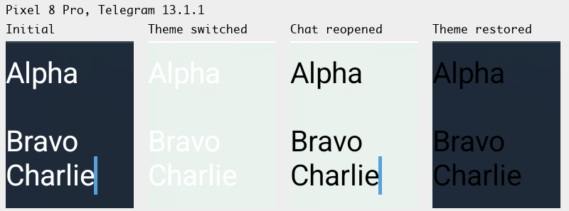
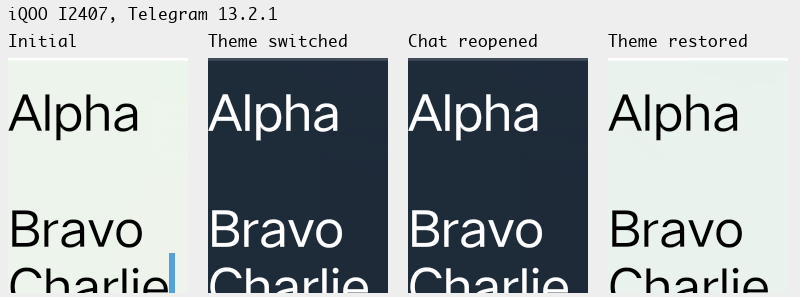

# Цвет текста в поле ввода после смены темы

[Обращение №67017](https://bugs.telegram.org/c/67017)

Статус проекта: воспроизведено на Pixel 8 Pro с Telegram 13.1.1. На том же Pixel и на iQOO с Telegram 13.2.1 дефект в открытом чате не проявился.

## Проверка

Набрать черновик и сменить системную тему в открытом чате. Сравнить цвет со свежим открытием того же чата.

## Проверка на устройстве

Системную тему меняли, пока в «Избранном» был открыт один и тот же синтетический черновик. Сняли поле ввода до переключения, через три секунды после него, после выхода и повторного открытия чата и после восстановления исходной темы. Сравнивали пиксели букв слова Alpha и фон непосредственно рядом с ним.

| Устройство | Смена темы | Открытый чат | После повторного открытия | Возврат настройки |
|---|---|---|---|---|
| Pixel 8 Pro, Android 17, Telegram 13.1.1 | Тёмная → светлая | Белые буквы остались на светлом фоне | Буквы стали чёрными | После возврата тёмной темы буквы остались чёрными до повторного открытия чата |
| iQOO I2407, Android 15, Telegram 13.2.1 | Светлая → тёмная | Чёрные буквы стали белыми | Буквы остались белыми | При возврате светлой темы буквы снова стали чёрными |

10 ноября 2026 после обновления того же Pixel до Telegram 13.2.1 повторили опыт с тем же черновиком. В области первой строки размером 200 × 80 пикселей насчитали 703 полностью чёрных пикселя после перехода на светлую тему и столько же после повторного открытия чата. В исходной и восстановленной тёмной теме в этой области было 703 полностью белых пикселя и ни одного полностью чёрного. Исходную системную тему восстановили. Обрезанные снимки и результаты измерения сохранены локально, временные XML с обоих телефонов удалены.

Для проверенного сценария отдельный патч не требуется. Сценарий перехода из уведомления остаётся непроверенным. Следующий тест по очереди — метаданные OGG в №67406.
