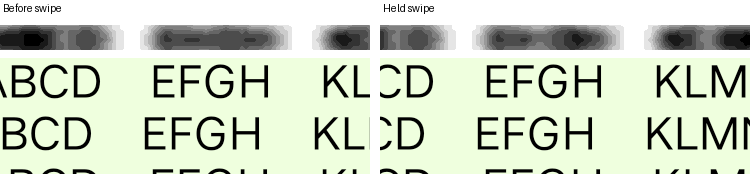

# Текст под панелью закрепа при свайпе ответа

[Обращение №67455](https://bugs.telegram.org/c/67455)

Статус проекта: на iQOO в проверенном сценарии дефект не воспроизведён.

## Проверка

Закрепить сообщение в тестовом чате, частично прокрутить текст под панель и записать свайп. Сравнить с GIF.

## Проверка на iQOO, 10 ноября 2026

iQOO I2407, Android 15, официальный Telegram 13.2.1. В «Избранном» закрепили длинное синтетическое текстовое сообщение и поместили часть строк под панель закрепа. В настройках Blur был включён, Liquid Glass выключен, режим энергосбережения Telegram не был активен. Для основного прогона включили Liquid Glass.

На экране 1080 × 2392 дважды начинали жест с x=540, y=680 и перемещали палец до x=420. Делали снимки до жеста и через 150 мс после последнего MOVE, удерживая палец. В отдельном контрольном прогоне завершили более длинный свайп и проверили, что открылся ответ на это сообщение. Жест из правой части экрана в «Избранном» открывает панель тем, поэтому такие кадры исключили.

В обоих прогонах максимум корреляции по яркости показал сдвиг текста ниже панели на 47 пикселей влево (r≈1,00), а размытого рисунка внутри панели — на 48 пикселей влево (r≈0,98). Для панели использовали прямоугольник x=625…824, y=275…299 вне надписи закрепа, для тела x=625…824, y=432…463. Сравнили каждый фрагмент удерживаемого кадра с эталоном при разных горизонтальных смещениях.

На удерживаемом кадре текст и его размытое изображение смещаются вместе. Трекер указывает POCO X8 Pro Max с Android 16 и Telegram 13.1.1. Кратковременное запаздывание во время движения и результат на заявленном устройстве этим прогоном не проверены.

После теста вернули Liquid Glass в исходное выключенное состояние, сняли тестовый закреп, удалили синтетическое сообщение и проверили исходный черновик.
